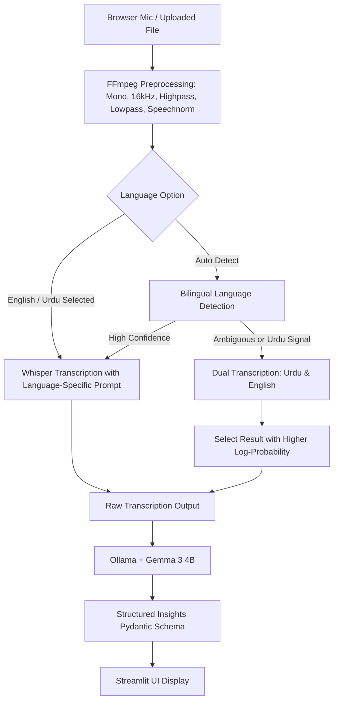
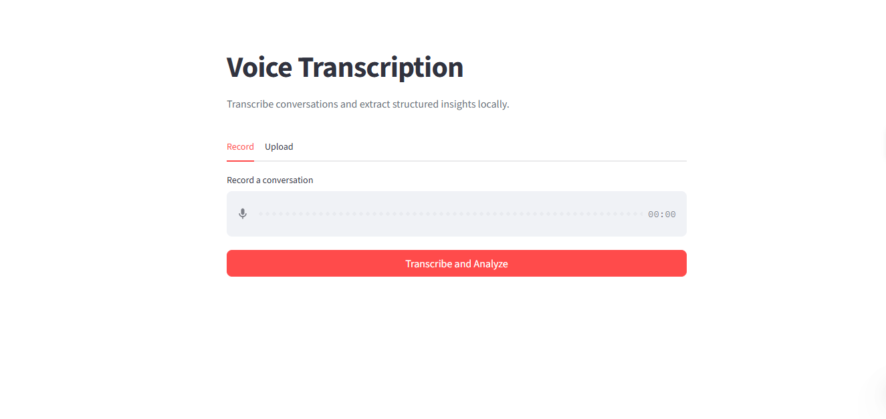
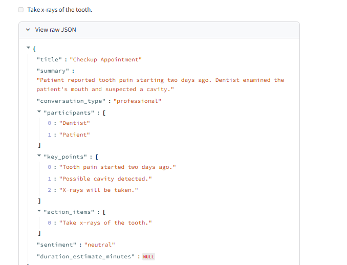

# 🎙 Local Voice Transcription & Insights Extractor

A private, fully offline voice transcription and intelligence gathering application. This tool captures or uploads audio, performs high-fidelity speech-to-text transcription on your CPU, and extracts structured insights using a local LLM.

Everything runs entirely on your local machine—no data ever leaves your computer, and no API keys are required.

---

## Key Features

- **🎙 Raw browser audio capture:** High-fidelity recording that bypasses WebRTC's compression and noise gates, ensuring clear voice data for Whisper.
- **⚡ CPU-Optimized Inference:** Powered by `faster-whisper` (CTranslate2) with `int8` quantization and CPU thread tuning tailored to prevent hyperthreading contention.
- **🧹 Advanced FFmpeg Preprocessing:** Clean audio signal containing filters for low-frequency rumble removal (highpass at 80Hz), high-frequency hiss removal (lowpass at 8000Hz), and EBU R128 loudness normalization (`loudnorm`, falling back to `dynaudnorm`).
- **🌐 Smart Urdu & English Auto-Detection:** Automatically runs a dual-language detection check. If speech is ambiguous or detected as Urdu, it transcribes both languages and selects the highest confidence result, resolving the standard English bias in default Whisper models.
- **📊 Structured Summaries:** Extracts structured data matching a strict JSON schema (conversation type, participants, key points, action items, and sentiment) using Ollama and Gemma 3.

---

## Technical Architecture



---

## Tech Stack

- **Frontend & App Wrapper:** [Streamlit](https://streamlit.io/)
- **ASR Engine:** [Faster-Whisper](https://github.com/SYSTRAN/faster-whisper) (CTranslate2)
- **Local LLM Engine:** [Ollama](https://ollama.com/) (running Gemma 3 4B)
- **Audio DSP:** [FFmpeg](https://ffmpeg.org/) (applied via Python `subprocess`)

---

## Configuration

You can customize the execution behavior using the following environment variables:

| Variable | Default Value | Description |
| :--- | :--- | :--- |
| `WHISPER_MODEL` | `small` | Whisper model size (`tiny`, `base`, `small`, `medium`, `large-v3`). `small` is recommended for 4-core mobile CPUs. |
| `OLLAMA_BASE_URL` | `http://localhost:11434` | The endpoint URL where Ollama is running. |
| `OLLAMA_MODEL` | `gemma3:4b` | The model name in Ollama used for summarization. |
| `OLLAMA_KEEP_ALIVE` | `30m` | How long Ollama keeps the model loaded between requests, so repeat runs skip reloading it. |

---

## Installation & Setup

### 1. Prerequisites
Ensure you have **Python 3.10+** and **FFmpeg** installed and added to your system path.
To check if FFmpeg is installed:
```bash
ffmpeg -version
```

### 2. Clone the Repository
```bash
git clone <repository-url>
cd STTRecognition
```

### 3. Install Dependencies
```bash
pip install -r requirements.txt
```

### 4. Setup Ollama
Download and run [Ollama](https://ollama.com/), then pull the Gemma 3 model:
```bash
ollama pull gemma3:4b
```

### 5. Launch the Application
Start the Streamlit interface:
```bash
streamlit run app.py
```

---

## CPU Optimizations Detailed
- **Core Threading:** Whisper is configured to initialize with `cpu_threads=4` (targeting physical cores on an Intel i7-8550U), preventing resource contention.
- **Decoding Stability:** Previous text conditioning (`condition_on_previous_text=False`) is disabled to prevent looping hallucinations and repeating word bugs.
- **Audio Capture Optimization:** Browser audio is requested at `48000 Hz` and captured at `128 kbps` without WebRTC echo cancellation or noise suppression to ensure the purest possible signal reaches Whisper.

---

## Demo




