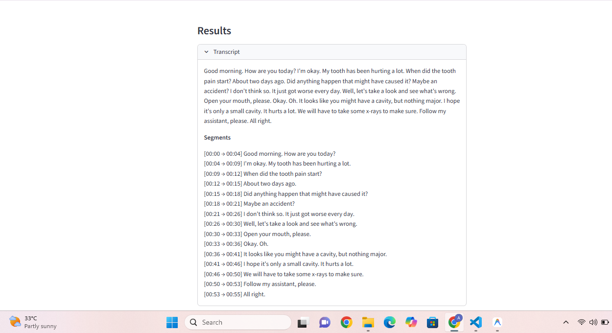

# 🎙 Voice Transcription & Intelligent Information Extraction

A local AI application that:

- Transcribes speech using Faster-Whisper
- Extracts structured information using Ollama + Gemma
- Displays results with Streamlit

Everything runs locally.

---

## Features

- Audio recording
- Audio upload
- Fast local transcription
- AI-powered structured summaries
- No cloud APIs
- Works offline

---

## Tech Stack

- Python
- Streamlit
- Faster-Whisper
- Ollama
- Gemma 3
- FFmpeg

---

## Installation

### Clone

git clone https://github.com/yourusername/voice-transcription-extraction.git

cd voice-transcription-extraction

### Install

pip install -r requirements.txt

### Start Ollama

ollama serve

ollama pull gemma3:4b

### Run

streamlit run app.py

---

## Example Workflow

Audio

↓

Whisper

↓

Transcript

↓

Gemma

↓

Structured JSON

↓

Streamlit UI

## Demo

